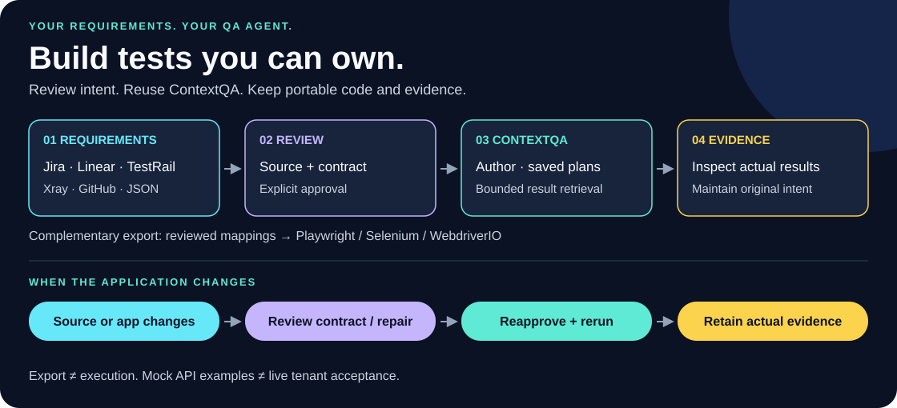

# ContextQA Test Forge

For **SDETs building their own QA agents**: turn reviewed requirements into ContextQA workflows and owned Playwright tests. Selenium and WebdriverIO exports are also available.

[ContextQA setup](docs/tokens.md) · [Customize your agent](docs/customization.md) · [Technical guide](docs/POWERFUL.md) · [Real testing](docs/real-testing.md)



## Try it locally

Requires **Node 22+**. From the repository root, use a fresh output directory:

```sh
npm test
node examples/contextqa-workflow.js output/contextqa-first-look
```

This uses **mock ContextQA transport and synthetic IDs**: no account, model call or paid run. Inspect `result.json`; do not submit the sample bundle live.

**Know the boundary:** exports do not execute tests. Live tenant/billing acceptance and native auto-healing remain unverified; notifications are delivery intents. Review source, assertions and actual results.

**Private candidate:** no open-source license or public release yet. Optional AI and hosted execution use separate credentials and may incur charges.

[Developer instructions](AGENTS.md) · [Security](SECURITY.md) · [Contributing](CONTRIBUTING.md) · [Capability evidence](docs/capability-register.md)
