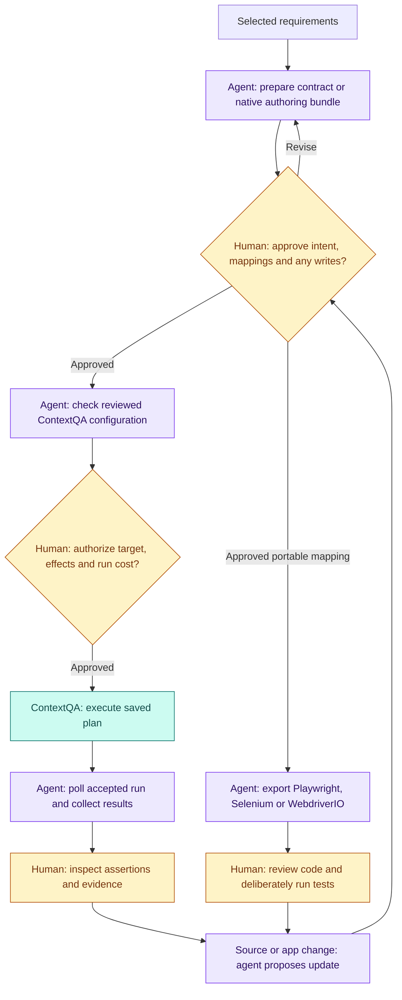

# ContextQA Test Forge — technical guide

[← Visual overview](../README.md)

This guide contains the detailed operating procedures, capability boundaries and reference links moved from the README. Commands run from the **repository root**, even though this document lives in `docs/`.

## Technical navigation

[Roles and human review](#roles-and-human-review) · [Make the agent yours](#make-the-agent-yours) · [Start with the ContextQA workflow](#start-with-the-contextqa-workflow) · [Complementary local framework example](#complementary-local-framework-example) · [Your real workflow](#your-real-workflow) · [What works, and what remains manual](#what-works-and-what-remains-manual) · [Product strategy and release plan](#product-strategy-and-release-plan) · [Install and test for real](#install-and-test-for-real)

## Roles and human review

ContextQA owns the managed automation service: native cases, suites, saved plans, configured environments/data/prerequisites/browser settings and the execution results available to the selected account. This repository supplies a local client and workflow tools; it does not replace that service. The adapter is mock-tested, while live tenant and billing acceptance remain pending.

A **custom agent** means your coordinator built from these tools: a Node script, CI job or separately configured coding assistant. It can prepare source snapshots, draft contracts or raw authoring bundles, check selected configuration, submit an explicitly approved operation, poll an accepted run, prepare portable exports and propose maintenance. Optional model drafting requires separate data-sharing consent. The toolkit does not install an autonomous agent or give a model authority to approve itself.

| Checkpoint | Agent prepares | Human decides | What happens next |
|---|---|---|---|
| Requirements and authoring | Source snapshot, exact contract or write bundle, known IDs and proposed assertions | Are the business intent, selectors/mappings, full payload and side effects correct? | Record source-bound approval; apply only explicitly authorized writes. Revisions need new review. |
| Managed execution | Selected saved-plan configuration and preflight result | Is this target, data, permitted side effect and potential cost authorized? | Start once with a fresh journal and poll the accepted run; an ambiguous start is not retried. |
| Portable code | Approved mapping and generated project | Does the code preserve the required assertions and fit the target application? | Deliberately run the generated project; exporting alone provides no pass/fail result. |
| Result and maintenance | Actual member results, evidence references and a proposed repair or PR | Is there enough evidence, and does the change preserve intent? | Accept a verified result, request a locator repair and rerun, or escalate a behavior change for requirement review. PR merge remains human-controlled. |

**Example:** a checkout requirement says an order above a limit needs approval. The human defines the limit and expected result; the agent prepares the contract and selected native configuration. After separate execution authorization, ContextQA runs the saved plan and the agent retrieves its results. The human checks that the actual assertion tests the limit. If a button locator changes, a reviewed locator repair must preserve that assertion and be rerun; a changed approval policy requires a new requirement decision.

Review receipts bind content hashes; they are not identity signatures or proof of execution. Native auto-healing is unverified, and notification output remains an unsent intent. See [custom-agent composition](custom-agent.md), [authoring and execution](contextqa.md), [maintenance](maintenance.md) and [GitHub publication controls](customization.md#publish-a-reviewed-plan-as-a-private-pull-request).

### Detailed approval flow



## Implementation map

| Layer | Implementation | Detailed contract |
|---|---|---|
| Source intake | `src/sources.js`, `src/transport.js` | [Sources](sources.md) |
| Approval and provenance | `src/contracts.js` | [Contracts](contracts.md) |
| Managed ContextQA workflow | `src/contextqa.js`, `src/contextqa-workflow.js`, `src/contextqa-project.js` | [API workflow](contextqa.md) |
| Portable code and ownership | `src/exporters.js`, `src/profile.js` | [Customization](customization.md) |
| Maintenance and publication | `src/maintenance.js`, `src/sync.js`, `src/github-sync.js` | [Maintenance](maintenance.md), [publication controls](customization.md#publish-a-reviewed-plan-as-a-private-pull-request) |
| Outcomes | `src/outcomes.js`, `src/reports.js` | [Measurement](measurement.md) |

ContextQA Test Forge helps **SDETs build their own QA agents**: turn requirements from Jira, Linear, TestRail, Xray Cloud, GitHub Issues or JSON into approved, owned **Playwright** tests, use **ContextQA's API** for managed automation, and preserve evidence when the application changes. Name your agent, choose inline or page-object code, define the business assertions, review the output and measure the result. Existing Selenium and WebdriverIO exports remain available.

Anyone can use Claude or another model to draft code. The SDET supplies the judgment that makes it useful: selecting the right workflow, resolving ambiguous requirements, checking assertions, handling maintenance and measuring business outcomes. [The SDET builder journey](sdet-builder.md) explains this role; [the custom-agent guide](custom-agent.md) shows the implemented API building blocks and their boundaries.

Built under `contextqaai` for [ContextQA](https://contextqa.com/?utm_source=github&utm_medium=developer_referral&utm_campaign=contextqa_test_forge&utm_content=readme_overview). This is a private, runnable first release. It is not a hosted service, marketplace-certified connector, universal natural-language-to-working-test guarantee or replacement for checking application behavior.

**Release status:** private candidate; an open-source license and public release are pending owner approval. Core local samples make no model or ContextQA SaaS calls. Optional AI and hosted execution use separate credentials and may incur provider charges.

## Make the agent yours

Start with [defaults and customization](customization.md): owner/agent/version, Playwright inline or Page Object Model, indentation, bug-report fields, notification subscriptions, generated/custom directories, branch/file prefixes and semantic-version recommendations. Source watches prepare review packets; approved code can be proposed through the guarded private GitHub PR publisher. Automatic merge is off. Slack/email/webhook output is a delivery intent; no destination is connected or message sent by the formatter.

```sh
node scripts/builder-profile.js init --name 'Your name' --agent 'My QA Agent' --out forge.profile.json
node scripts/builder-profile.js validate --profile forge.profile.json
```

Generated files contain truthful owner/reviewer attribution and criterion-to-assertion mappings; these do not change Git author identity or prove a run passed. [Run the five-scenario Playwright example](builder-acceptance.md) to see real success/failure, a reviewed locator repair and a behavior change that must be escalated. [Maintenance](maintenance.md) preserves original assertions; native ContextQA-to-Playwright auto-healing remains unverified. [Outcome reporting](measurement.md) keeps measured time, reported tokens, unknown costs and business benefit separate.

## Start with the ContextQA workflow

The [token guide](tokens.md) explains **where to obtain a token and exactly where to put it**. The [ContextQA workflow guide](contextqa.md) covers reusable environment/data/prerequisite/browser settings, reviewed authoring, durable partial-write journals, saved-plan execution, result retrieval and complementary code exports. The bundled client catalogs all 40 operations from the supplied token API contract; its schema/transport tests are mocked, not live-account acceptance.

```sh
npm test
node scripts/contextqa.js operations
node examples/contextqa-workflow.js output/contextqa-new-sample
```

The account-free example uses a **mock ContextQA transport**: nine raw authoring operations, case/step reads and three explicit portable mappings. Every tenant ID is synthetic; do not send its bundle live. No API key, paid execution or model call occurs. For actual usage, obtain a scoped ContextQA token and use reviewed account configuration; authoring writes and potentially billed execution have separate approval gates. Environments/data/device discovery are not invented where the contract supplies no endpoints. BYOK OpenAI/Claude drafting is optional and independent.

## Complementary local framework example

Requires Node 22+. The core has no npm runtime dependencies and needs no source account or AI key.

```sh
npm test
node examples/demo.js output/demo
```

This imports six synthetic source fixtures and exports **18 projects**: each source in each of the three frameworks. Inspect `output/demo/metrics.json`, the source snapshot, structured contract, approval receipt and generated test. The fixture is an invented HTML preferences form, not customer data.

Run one exported project explicitly:

```sh
cd output/demo/github-playwright
npm install
npx playwright install chromium
npm test
```

For `github-selenium` or `github-webdriverio`, install Chrome, then `npm install` and `npm test`. Projects pin framework versions. Exporting never runs tests. [CI run 40601770497](https://github.com/contextqaai/contextqa-test-forge/actions/runs/40601770497) passed the unit job and real synthetic browser tests in all three frameworks for commit `4f6417f` on October 27, 2026. That historical run did not test live source credentials, AI providers or hosted ContextQA execution. [Fresh installation, positive/negative browser controls and live acceptance steps](real-testing.md) explain how to verify your current checkout. A generated file is not a passing result.

## Your real workflow

1. Choose an explicit source item and read-only key; use [source endpoint and token setup](sources.md).
2. Fetch it or import an existing JSON response.
3. Optionally use [your AI key](ai.md) to draft requirements from content you explicitly approve sharing.
4. Author a structured contract with verified CSS selectors, staging URLs, environment references and expected results. The demo contains a complete example.
5. Review the source and contract, record approval, export and inspect the project.
6. Prefer the [ContextQA API workflow](contextqa.md) with an approved existing plan and native settings; use portable exports when code ownership/framework integration is needed. Run only in an authorized disposable test workspace and retain actual result evidence.
7. When the source or app changes, re-fetch, update selectors/expectations, compare contracts, reapprove and re-run.

```sh
node src/cli.js fetch --config examples/config/github.json --out source.json
# Or import a saved response:
node src/cli.js import --platform github --input examples/fixtures/github.json --out imported.json
# After authoring contract.json with sourceSha from source.json:
node src/cli.js approve --contract contract.json --source source.json --reviewer 'Your Name' --confirm-reviewed --out approval.json
node src/cli.js export --contract contract.json --approval approval.json --framework playwright --out new-project
node src/cli.js diff --before old-contract.json --after contract.json --out change-report.json
```

Output files and directories must be new. Store real source, contracts, credentials and results outside the repo or in ignored `private/`, `.ai-private/` or `output/`. No customer test source is needed to try the example.

## What works, and what remains manual

| Capability | Current implementation |
|---|---|
| ContextQA primary API route | Fixed-origin client/catalog for 40 documented operations; request schemas, scopes/effects, explicit write/execute approval and bounded saved-plan polling. Mock-tested; live account and billing acceptance remain outstanding. |
| Native reusable authoring | Source-bound raw case/step/suite/plan bundles; created-ID references, preflight validation and durable no-replay partial-write journal. Existing environment/data/prerequisite/browser/parallel settings remain explicit. |
| ContextQA → portable code | Explicit case/step reads with parent checks, then manually reviewed selector/action mapping covering selected source step IDs. No automatic NLP/element-ID conversion. |
| Jira Cloud, Linear, TestRail, Xray Cloud, GitHub Issues | Single-item read adapters; fixture/transport tested. Real tenant credentials not tested here. |
| Other platforms | Map their export into the canonical JSON source shape; no universal live connector claim. |
| AI | Optional local drafting with OpenAI Responses, Anthropic Messages or compatible Chat Completions; mock-tested, not live-billed. |
| Three automation frameworks | JavaScript projects with real assertions, waits, pinned dependencies and guaranteed cleanup for Selenium/WDIO. |
| Review and provenance | SHA-256-bound contract approval; changed contracts require approval again; traceability per project. |
| Builder customization | Self-declared owner/agent/version, business criteria/assertions, Playwright inline/POM and indentation; generated/custom directories remain separate. |
| Maintenance | Classify failures; review selector-only proposals, preserve intent/assertions/native mappings and require rerun. No automatic native healing claim. |
| Source subscriptions and GitHub | Explicit watch lists, manual/dispatch/scheduled workflow generator, source-hash review gate and private PR publisher with durable journals. Mock-tested publication; subscriptions are not installed by generating a file. |
| Reporting | Measured local durations, provider-reported AI usage, baseline/denominator-aware outcome summaries and customizable bug reports. Notifications prepare delivery intents only. |
| Not implemented | Bulk pagination, custom Jira fields, Xray Server/DC, source writeback, result synchronization, secret vault hosting, live browser discovery, mobile/native, file upload, shadow DOM/frame mappings or arbitrary code steps. |

Supported steps: navigate, click, fill, native-select by value, checkbox check, exact text, visibility and exact URL assertions. CSS selector semantics and displayed text can differ across engines; verify on your app. Each test requires at least one assertion. Missing selectors, unsupported actions and changed approval hashes fail closed. Review receipts are local process controls, not cryptographic identity signatures.

Read [installation and real testing](real-testing.md), [contract schema and lifecycle](contracts.md), [source APIs and keys](sources.md), [AI configuration](ai.md), [use cases and comparisons](use-cases.md), [metrics](metrics.md), [security](../SECURITY.md), and [contributing](../CONTRIBUTING.md).

New builder documentation: [customize and subscribe](customization.md) · [ContextQA/token setup](tokens.md) · [custom agent tutorial](custom-agent.md) · [real local lifecycle](builder-acceptance.md) · [maintenance design](maintenance.md) · [business outcome measurement](measurement.md) · [implementation status](builder-status.md).

Related ContextQA reading: [recording browser workflows](https://contextqa.com/tutorials/no-code-test-automation-recorder/?utm_source=github&utm_medium=developer_referral&utm_campaign=contextqa_test_forge&utm_content=readme_recorder) and [reviewing visual baselines](https://contextqa.com/blog/visual-regression-testing-ui-stability/?utm_source=github&utm_medium=developer_referral&utm_campaign=contextqa_test_forge&utm_content=readme_visual_blog). Related repos: [browser sessions and evidence](https://github.com/contextqaai/contextqa-browser-cloud), [documentation evidence handoffs](https://github.com/contextqaai/contextqa-docs-evidence). This repo calls the existing ContextQA cloud API; it does not deploy a new hosted endpoint.

## Product strategy and release plan

[Growth strategy and two-recipe specification](GTM.md) · [Capability evidence](capability-register.md) · [Prioritized implementation backlog](backlog.md) · [Audience and fair comparisons](comparisons.md). These are local release drafts; proposed API flows, commands and commercial claims are explicitly gated. No public open-source release or hosted service is implied.

## Install and test for real

Follow the [fresh-install and real-testing guide](real-testing.md) for observed test coverage, a reproducible local path, expected failures and the remaining live-account acceptance checks. Synthetic browser results are separate from real source/AI credentials and customer staging workflows.
