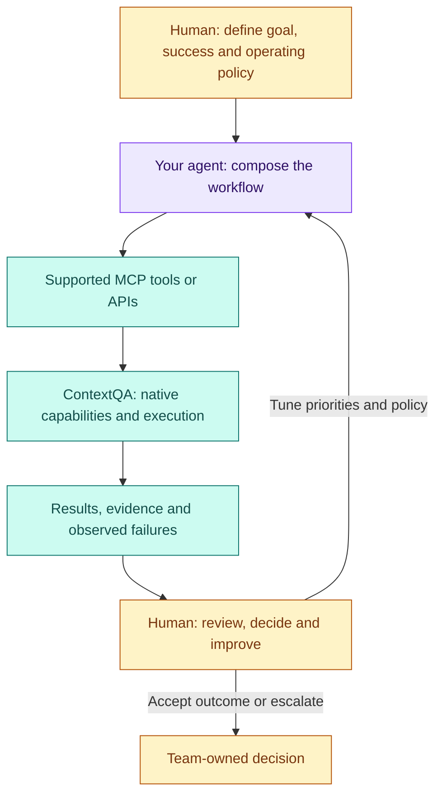

# Build your own agent on ContextQA

**You bring the workflow. ContextQA brings the quality capabilities. Your team owns the decisions.**

Build a release-readiness assistant, a business-rule guardian or a documentation agent using the ContextQA capabilities your team already uses. Customize what matters to your business: the goal, selected context, test priorities, review policy and useful output. Reuse native execution, saved configuration and evidence instead of rebuilding a browser engine, test platform or orchestration service.

[Choose a recipe](recipes.md) · [Build your first agent](first-agent.md) · [Explore the capability map](capabilities.md) · [Human review and optimization](human-loop.md)



## See it → try it → build it → own it

| Stage | What you do | What you leave with |
|---|---|---|
| See it | Pick one real business journey and the relevant ContextQA capabilities. | A clear goal and acceptance criteria. |
| Try it | Run the existing account-free examples; inspect both useful output and limitations. | A local agent profile, review artifacts and a workflow you understand. |
| Build it | Add your business policy and selected tool bindings; retain native ContextQA execution. | A small coordinator tailored to your team. |
| Own it | Validate one authorized real journey, review failures, tune the workflow and repeat. | Named ownership, measured results and a maintainable review process. |

## What you reuse, what you create

| ContextQA foundation | Your custom layer | Human contribution |
|---|---|---|
| Native cases, plans, prerequisites, data/environment references and execution settings | Select the relevant workflow and bind approved configuration | Define business intent, risk, target and permitted effects |
| Available tools/APIs and result evidence | Connect selected context to tools; format a decision packet | Review coverage, assertions, failures and uncertainty |
| Platform capabilities across the quality lifecycle | Add team-specific prioritization, handoffs and policies | Orchestrate owners/dependencies and improve the process |

An agent can be a script, CI coordinator or tool-using assistant. A model is optional. Use ContextQA's native orchestration where it fits; custom coordination adds your team's policy and connections around it. Start with the smallest useful workflow, not a new general-purpose agent framework.

## Start here

From this repository root, with Node 22+ and a new output directory:

```sh
node examples/customize-agent.js output/my-first-agent
```

Open `profile.json`, `contract.json`, `sync-plan.json` and `README.md` inside that directory. This existing offline sample prepares a fictional agent, reviewed synthetic inputs and local artifacts. It sends no messages, installs no workflow and calls no model or ContextQA service. Continue with [the guided customization exercise](first-agent.md).

**Choose the implementation home:** use Test Forge for source-to-test workflows, owned code, maintenance and reporting. Use [Docs Evidence](https://github.com/contextqaai/contextqa-docs-evidence) for reviewed workflow-to-guide exports and refresh comparisons. Share capability/policy concepts; keep execution and rendering in their existing implementations.

## Product capability and callable interface are different

The supplied platform map describes eight phases and 54 capabilities. This repository's token client exposes a narrower, contract-derived interface; a capability's presence in the product map does not name an API operation. The [capability guide](capabilities.md) separates product reuse from concrete toolkit entry points. Confirm the selected tenant's supported MCP/API interface before binding a tool. These repositories remain private candidates without an open-source license; the deck's general reference to open-source building blocks does not change that status.

Design basis: the owner-supplied ContextQA system map and [the pilot deck, especially slides 6–8](https://docs.google.com/presentation/d/1Y8Z2Gkh3awvq1UUd2a3tDifxNZ1qudlwhifflToqxqk/edit?slide=id.p6#slide=id.p6), reviewed November 5, 2026. The map is product context; repository interface claims are grounded in [the capability register](../capability-register.md) and [custom-agent tutorial](../custom-agent.md).
