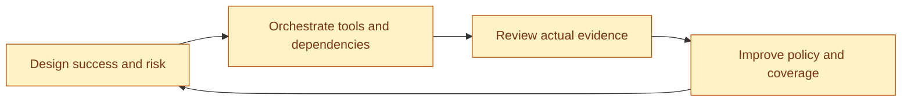

# Humans design, orchestrate and optimize the agent

[Builder hub](README.md) · [Agent brief](agent-brief.md)

Human participation is a continuous operating role. The team chooses the useful problem, defines quality, coordinates execution and learns from evidence. Approval is one checkpoint inside that work.

| Human role | Before work | During review | How they improve the agent |
|---|---|---|---|
| Product owner / BA | Define business outcomes and ambiguous requirements | Check that assertions express the intended behavior | Refine examples, acceptance criteria and missing scenarios |
| Automation engineer | Compose narrow tools and explicit mappings | Inspect code, configuration drift and repair proposals | Improve maintainability and remove repetitive preparation |
| Manual tester | Contribute exploratory questions and edge cases | Challenge evidence and investigate unexpected behavior | Add scenarios automation has missed |
| QA lead | Choose risk priorities, coverage and review ownership | Accept, revise or escalate the decision packet | Tune suite selection using observed defects and reviewer burden |
| Developer | Explain implementation changes and expected behavior | Review reproducibility and proposed fixes/code changes | Improve testability and diagnostic context |
| DevOps / SRE | Coordinate target environment, dependencies and execution windows | Check revision identity, infrastructure issues and bounded execution | Improve repeatability, runtime and resource use |
| Engineering leader | Define pilot success and ownership | Decide whether evidence supports expansion | Compare support effort and demonstrated outcomes |
| Support / CS | Provide a scoped customer problem and useful reproduction context | Validate the customer-facing explanation | Feed recurring problems into the next coverage cycle |
| Security / compliance | Define sharing boundaries and sensitive-data handling | Review content, media rights and allowed destinations | Refine evidence minimization and review policy |

One person can hold several roles. Name who owns each decision in the brief so an agent can route an unresolved question to someone specific.

## Make review actionable

The agent prepares the requirement and proposed action, precise scope/configuration, side effects and cost uncertainty, relevant artifacts, observed outcomes, missing evidence and a recommended next step. The reviewer chooses **accept**, **revise**, **reject** or **escalate**, with a reason. The agent then prepares the next permitted action; it does not sign its own human approval.

Separate content approval from permission to write or start a run. Changed source/contract hashes invalidate the relevant approval. Changed business behavior returns to requirement review; a locator repair preserves assertions and needs rerun evidence. Partial writes and ambiguous execution starts require reconciliation, not blind retries. Use the existing journals and hash checks instead of implementing another ledger.

## Orchestrate deliberately

Reuse native ContextQA plans, prerequisites, data/environment references, browser settings and available orchestration. Humans select the intended configuration, coordinate dependencies and authorize effects/cost. The custom agent connects selected context and team-specific policies to that native workflow. A new assistant prompt does not grant a token more authority or install a scheduler.

## Optimize from observations

| Question | Useful observation | Possible human-led change |
|---|---|---|
| Does it protect the right behavior? | Negative-control failures and business assertions actually checked | Add a missing criterion or revise test selection |
| Is review worthwhile? | Reviewer corrections and time per accepted result | Improve the input packet or make the task narrower |
| Can the team own it? | Ability to change and repeat the workflow without bespoke vendor operation | Improve the profile, instructions and handoff |
| Is it reliable? | Repeated failures, inconclusive runs and confirmed flaky behavior | Improve fixture/data stability or investigate infrastructure |
| Is expansion justified? | Repeat use, maintenance effort and known costs against a baseline | Extend one adjacent journey or stop an unhelpful recipe |

Use [measurement](../measurement.md) for denominator-aware reporting. Unknown usage/cost remains unknown. Expand autonomy only through an explicit owner-approved policy and supporting implementation; these docs do not enable new automatic approvals, deployment or publication.
